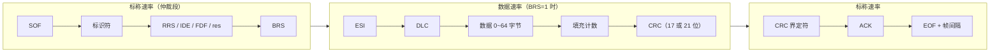
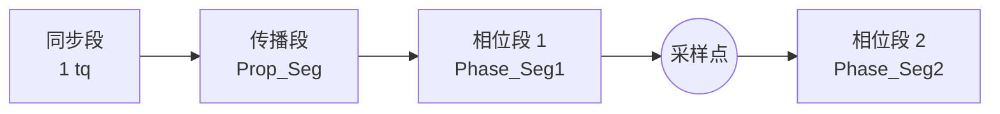
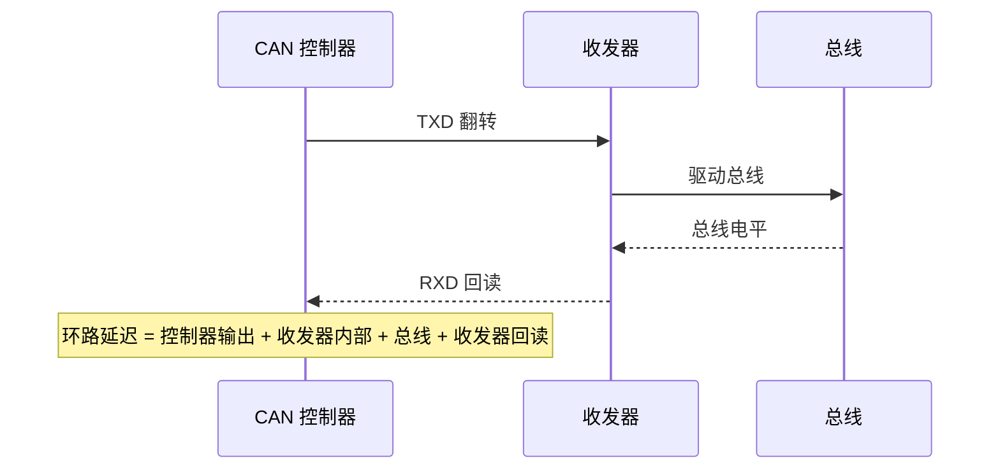
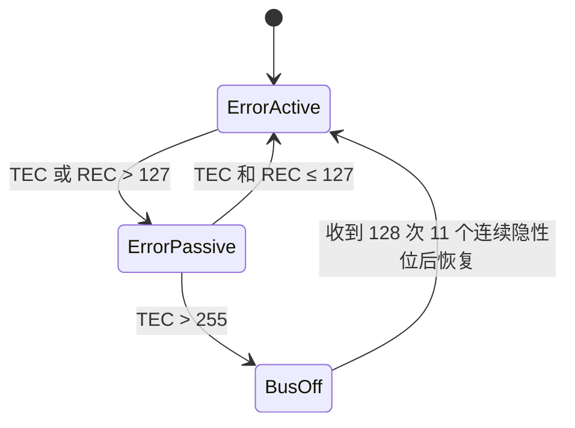
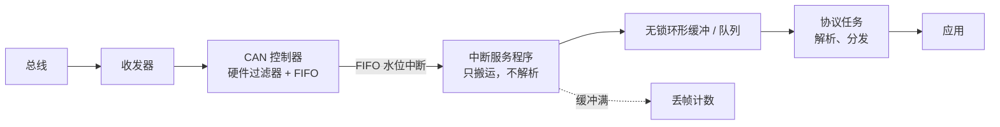

大多数人对 CAN-FD 的认识停留在"数据段更快、一帧最多 64 字节"。这没错，但真正把它用在一条多节点总线上，问题往往出在别处：**位时序参数配得"能通但不稳"、总线利用率估算和实际差一大截、节点掉线后恢复行为不符合预期**。

这篇文章按"帧怎么组成 → 位时序怎么配 → 总线到底能传多少 → 出了错会怎样 → 怎么调试"的顺序，把这些点串起来。读完你应该能自己算一条总线的负载，并对"为什么高速数据段需要延迟补偿"有清晰的认识。

> 前提：你已经用过 CAN 或 CAN-FD 控制器，知道标识符优先级和仲裁的基本概念。本文不涉及具体芯片寄存器。

## 1. 一帧 CAN-FD 里，哪些位跑在哪个速率

CAN-FD 最关键的设计是**把一帧拆成两个速率区间**：仲裁需要所有节点同步所以保持慢，数据段只有一个发送者所以可以提速。



要点：

- **BRS 位**决定这一帧是否切换到数据速率。它自己在标称速率下被采样，所以边界附近有专门的相位对齐处理。
- **DLC 不是线性的**：0~8 对应 0~8 字节，之后 9→12、10→16、11→20、12→24、13→32、14→48、15→64。凑不满的长度必须补齐，补多少属于应用层约定。
- **CRC 随长度变化**：数据 ≤16 字节用 17 位 CRC，更长用 21 位。
- **ISO 与非 ISO 版本不兼容**：ISO 11898-1:2015 在 CRC 前加入了"填充计数"字段并改了 CRC 初值，早期（Bosch 原版）控制器与它互不理解。新设计一般选 ISO 版本，**混用旧控制器时要核对**。

## 2. 位时序：能通和稳定之间差几个参数

CAN 把一个位切成几段，采样点落在其中：



一个位的总长 = `1 + Prop + PS1 + PS2` 个时间量子（tq）；采样点位置 =（`1 + Prop + PS1`）/ 总长。

经验上：

- **标称段**：采样点建议 80%～87.5%，传播段要覆盖"总线长度 + 收发器延迟 + 控制器延迟"的往返时间。
- **数据段**：位时间短，采样点通常取 70%～80%，容限比标称段小得多。
- **SJW（再同步跳转宽度）**：决定每次再同步最多调整多少 tq，晶振误差越大越需要加宽，但太大会吃掉容限。

两套参数的约束不同：标称段要满足**整条总线的传播延迟**，数据段要满足**位时间内的采样稳定性**。

### 为什么高速数据段需要"发送延迟补偿"（TDC）

发送节点自己的 RX 引脚会回读自己发出的信号（用来检测位错误）。这条路径是：



数据速率较低时，环路延迟远小于一个位，回读正常采样即可。但数据段速率升到几 Mbit/s 后，位时间可能只有几百纳秒，**环路延迟会接近甚至超过一个位**，用普通采样点就会采到上一位。

TDC 的做法：在每个 FD 帧的 BRS 边沿**实测一次环路延迟**，再加上一个可配置的偏移，把"二次采样点"（SSP）设在 `测得延迟 + 偏移` 处。因此：

- 数据速率较高时必须**开启 TDC**，并正确设置偏移；
- 偏移不是越大越好，要结合数据段采样点的位置计算；
- 换了收发器型号后需要重新验证，因为收发器内部延迟差别很大。

## 3. 总线到底能传多少：自己算一次

很多人用"速率 × 倍数"估吞吐，结果和实测差很多。更准确的做法是算一帧**占用多少时间**。

```text
帧时间 = 标称段位数 / 标称速率 + 数据段位数 / 数据速率
有效吞吐 = 数据字节数 / 帧时间
```

举例（标准 11 位 ID，忽略填充位，仅为估算）：

| | 经典 CAN，8 字节，1 Mbit/s | CAN-FD，64 字节，标称 500 k / 数据 2 M |
|---|---|---|
| 标称段位数 | 约 111（整帧） | 约 29（仲裁 + 尾部） |
| 数据段位数 | — | 约 548（含 DLC、CRC、填充计数） |
| 帧时间 | 约 111 µs | 约 58 µs + 274 µs ≈ 332 µs |
| 有效吞吐 | 约 72 KB/s | 约 193 KB/s |

结论：**FD 并不会让每字节快 4 倍，只有约 2.5～3 倍**，因为仲裁段和尾部依然在慢速率下。想继续提高，要么提高标称速率（受总线长度限制），要么让每帧尽量装满。

再看三个影响估算的因素：

1. **位填充**：每 5 个相同位插 1 个反相位，最坏情况多出约 20% 的位。对 FD 帧，数据段内的填充规则有变化（CRC 段使用固定填充位），不能照搬经典 CAN 的公式。
2. **帧间隔**：每帧之间至少 3 位。
3. **负载率**：周期性报文超过约 50%～60% 的总线负载，低优先级报文延迟就会明显抖动；超过 80% 以上基本没有裕量。

> 建议：设计阶段把所有周期报文列成表，用上面的公式算最坏负载，而不是等实测。

## 4. 错误处理：节点会怎样"掉线"

CAN 的错误限制是一个很值得理解的机制，它决定了故障节点会不会拖垮总线。



- **发送错误计数（TEC）**：发送出错 +8，成功 -1；
- **接收错误计数（REC）**：接收出错 +1（某些情况 +8），成功 -1；
- **Error Passive**：节点仍能通信，但发错误帧时只发被动错误标志，不会打断别人；
- **Bus-Off**：节点自己断开总线。**恢复要等 128 次 11 个连续隐性位**，也可以由软件主动重启。

这带来几个工程上的结论：

1. **速率不一致的节点**会不断产生错误帧，先变成 Passive，再 Bus-Off。排查时先看谁在报错，而不是谁在"收不到"。
2. **Bus-Off 之后是否自动恢复**是一个明确的设计决策：自动恢复让系统更健壮，但可能让一个有故障的节点反复干扰总线；手动恢复更安全，但需要上层有人处理。
3. 应用层应该**监控错误计数和 Bus-Off 次数**并上报，而不是等总线上出现症状。

## 5. 物理层：不是软件的问题也会让你查很久

- **终端电阻**：总线两端各 120 Ω。缺一个，低速时可能正常，速率上去反射就会出现偶发错误。
- **分支（stub）长度**：数据速率越高，允许的分支越短。星形连接在高速下很容易出问题。
- **收发器**：确认它标注支持你要的数据速率；高速场景可以考虑带信号改善功能（SIC）的型号，它能减少振铃。
- **共模范围与接地**：节点之间地电位差过大会让通信不稳。
- **经典 CAN 节点与 FD 节点混挂**：经典节点看到 FD 帧会当成错误并发出错误帧，破坏通信。要么全 FD，要么让控制器支持"FD 容忍"模式。

## 6. 软件侧：接收路径怎么设计才不丢帧



我的建议：

1. **硬件过滤器优先**：能在控制器里滤掉的帧不要进软件；
2. **中断里只做搬运**，解析放到任务里；
3. **缓冲满时丢帧并计数**，不要阻塞中断；计数要能被诊断接口读出来；
4. **报文丢失检测**：周期报文里放一个滚动计数，接收端检查连续性；
5. **时间戳**：控制器提供硬件时间戳的话，用它而不是中断里读定时器，后者会被调度抖动污染。

## 7. 调试：先看什么

| 现象 | 先怀疑 | 怎么确认 |
|---|---|---|
| 完全没有帧 | 速率不一致、终端电阻、收发器没使能 | 示波器量差分信号，或用抓包工具看错误帧 |
| 偶发错误帧，速率越高越多 | 采样点、TDC、反射 | 把数据速率降一档看是否消失 |
| 个别节点反复 Bus-Off | 该节点时序参数错或晶振误差大 | 对比它和其他节点的位时序配置 |
| 负载一高就丢报文 | 接收 FIFO 太浅、中断被压住 | 看丢帧计数和中断延迟 |
| 换了收发器后不稳 | 环路延迟变化，TDC 偏移不对 | 重新测量并调整 SSP 偏移 |

## 8. 取舍与局限

- 想要更高吞吐，别只盯着数据速率：先看帧里有多少是"开销"，再决定要不要提高标称速率或加大帧长。
- 本文没有讨论 CAN XL、时间触发（TTCAN）、上层协议（如 CANopen FD、J1939）和安全机制（SecOC）。
- 示例数值是估算，**不能替代实测**。

## 延伸阅读

- ISO 11898-1:2015（数据链路层）与 ISO 11898-2（高速物理层）。
- Bosch 的 CAN FD 规范（对比 ISO 与非 ISO 差异）。
- 收发器厂商的应用笔记：位时序与 TDC 设置、环路延迟测量。
