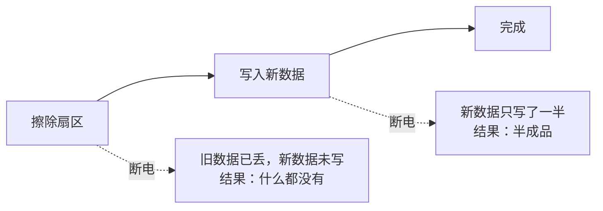
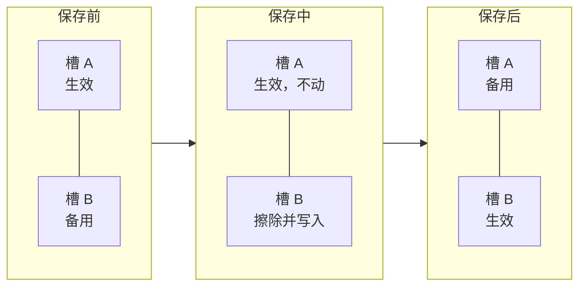
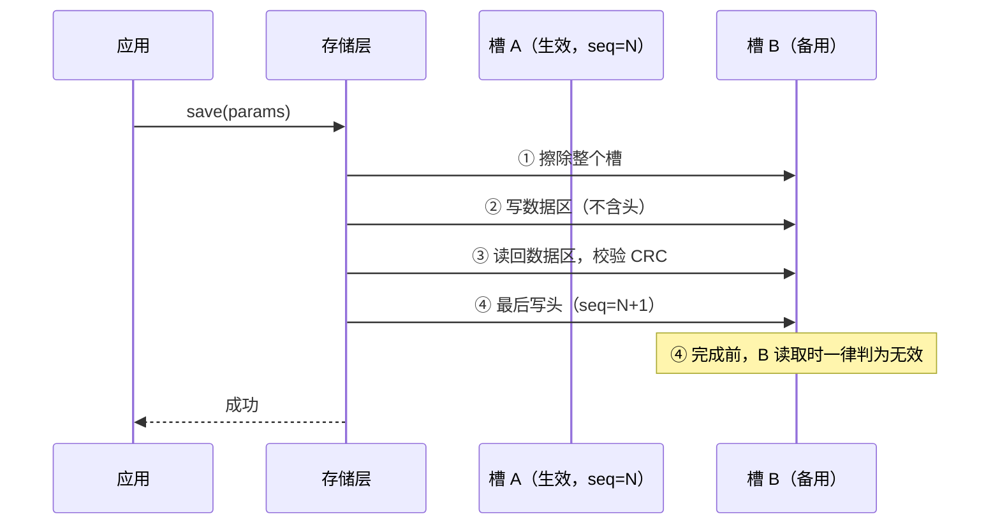
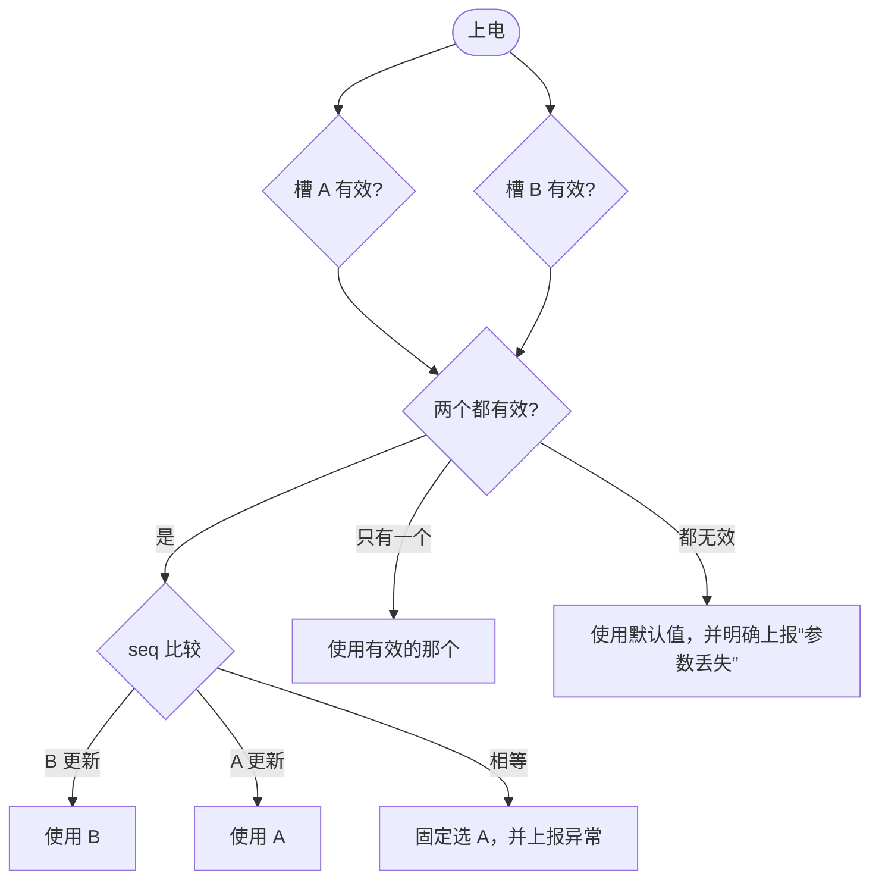
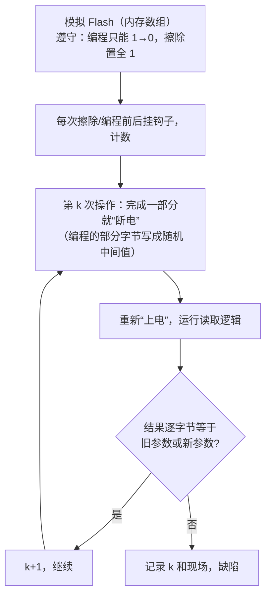

几乎每个设备都要保存几十到几百字节的配置或标定参数，几乎每个团队的第一版实现都长这样：

```c
flash_erase(PARAM_SECTOR);
flash_write(PARAM_SECTOR, &params, sizeof(params));
```

实验室里反复测试都没问题，直到某天现场有人在保存的瞬间拔了电源，设备上电后读到一块全 FF 或者半新半旧的数据。这类问题的麻烦在于**极难复现**：窗口只有几十到几百毫秒（擦除一个大扇区的时间），而且发生在最不该发生的场合。

这篇文章不是介绍某个现成的库，而是**从约束出发，一步步把 A/B 双槽设计推出来**，并讲清楚每一步在防什么、代价是什么、怎么证明它真的安全。读完你应该能判断：自己的场景要不要用 A/B，用的话哪些细节容易写错。

> 范围：NOR Flash 上、整体替换式的小参数块（几十字节到几十 KB）。高频小更新、大量参数的场景在文末讨论。

## 目标：把"掉电安全"说成可验证的一句话

> 在保存过程的**任意时刻**断电，下次上电读到的内容，必须**逐字节等于旧参数，或逐字节等于新参数**。

后面所有设计都服务于这一句。它的好处是能写成断言，进而写成自动化测试。

## NOR Flash 的几条"规则"

设计之前先看清对手：

| 规则 | 直接后果 |
|---|---|
| 编程只能把 1 变成 0，擦除才能把整块变回 1 | 不能原地改一个字节，改动要么整块先擦，要么只改 1→0 的位 |
| 擦除按扇区（几 KB 到上百 KB） | 擦一次，扇区里所有东西都没了 |
| 擦除很慢（几十到几百毫秒） | 断电窗口很宽，不是一个"瞬间" |
| 擦写寿命有限（通常 1 万到 10 万次量级） | 频繁保存要算寿命 |
| 擦除/编程被打断后，内容**不保证**是全 1 或全 0 | 位可能处于中间电平，两次读出来的值可能不同 |

最后一条是最容易被低估的：**被打断的擦除不等于"空白"**。设计里不能依赖"没擦完的地方会读成 FF"，只能依赖校验失败。

## 第 1 步：单副本为什么不行



窗口里断电，旧数据和新数据都不完整。要想"总有一份完整的"，就得**在写新数据的时候，旧数据还完整地躺在别处**。

## 第 2 步：两个槽，永远写"不当前生效的那个"



这一步解决了"旧数据在写新数据时丢失"。代价是空间翻倍。

但它引出一个新问题：**上电时怎么知道哪个槽有效、哪个更新？** 如果槽 B 只写了一半，它的内容看起来也像"有数据"。

## 第 3 步：让槽能"自证完整"

给每个槽加一个头，**头最后写**，作为提交记录：

```c
typedef struct {
    uint32_t magic;       /* 区分"写过"和"从未写过/垃圾" */
    uint32_t seq;         /* 单调递增的序号，决定谁更新 */
    uint32_t length;      /* 数据区长度 */
    uint32_t data_crc;    /* 数据区的 CRC32 */
    uint32_t header_crc;  /* 以上字段的 CRC32，头自己也要能自证 */
} slot_header_t;
```

保存流程，每一步的顺序都有理由：



| 断电发生在 | 备用槽的状态 | 上电结果 |
|---|---|---|
| ① 擦除中 | 不稳定内容、没有有效头 | 用 A（旧） |
| ② 写数据中 | 没有头 | 用 A（旧） |
| ③ 校验前后 | 没有头 | 用 A（旧） |
| ④ 写头中 | 头可能只写了一部分 | 头 CRC 不过 → 用 A（旧） |
| ④ 完成后 | 完整的头和数据 | seq 更大 → 用 B（新） |

注意第 ④ 行：**"写头中"安不安全，靠的不是时序，而是头 CRC 的检测能力**。头里每个字都可能是中间态，只要它们拼在一起恰好通过 CRC 的概率足够低，就可以当作"无效"。所以头里的 `header_crc` 不是装饰。

## 第 4 步：上电选择逻辑

```c
typedef enum { SLOT_INVALID, SLOT_VALID } slot_state_t;

static slot_state_t slot_check(const slot_t *s)
{
    const slot_header_t *h = &s->header;
    if (h->magic != PARAM_MAGIC)                         return SLOT_INVALID;
    if (crc32(h, offsetof(slot_header_t, header_crc))
            != h->header_crc)                            return SLOT_INVALID;
    if (h->length == 0 || h->length > SLOT_DATA_MAX)     return SLOT_INVALID;
    if (crc32(s->data, h->length) != h->data_crc)        return SLOT_INVALID;
    return SLOT_VALID;
}

/* 返回 1 表示 a 比 b 新；用有符号差值，序号回绕也正确 */
static int seq_newer(uint32_t a, uint32_t b)
{
    return (int32_t)(a - b) > 0;
}
```



三个容易被忽略的细节：

- **相等怎么办**：理论上不会出现，但必须有定义的行为，否则就是未定义行为。
- **都无效怎么办**：回到默认值，并且让上层**知道**发生过。悄悄用默认值，现场问题会变成"设备行为莫名其妙"。
- **序号回绕**：用 `(int32_t)(a - b) > 0`，不要用 `a > b`。

## 落地时真正会踩的坑

**1. 代码在同一片 Flash 里执行（XIP）。** 擦除和编程期间 Flash 不能同时被取指。常见做法：

- 擦写函数及它调用的一切放在 RAM 里执行；
- 或者调用芯片 ROM 提供的擦写接口；
- 擦写期间，中断服务程序也必须在 RAM 里，否则一个中断就会跑飞。

**2. 看门狗。** 擦一个大扇区可能超过喂狗周期。擦除可以拆成按页进行，页与页之间喂狗；但要确认你的 Flash 是否支持这样的分段擦除。

**3. 擦写寿命。** 两个槽轮流写，每个槽承担一半写入：

```text
总保存次数 ≈ 擦写寿命 × 2
```

假设寿命 10 万次，设备一生保存几百次，毫无压力；如果某个功能每分钟保存一次，一天就是 1440 次，要么降频，要么换方案。

**4. 写前先擦备用槽，不要"续写"。** 备用槽上次可能写到一半，里面是半成品。

**5. 读回校验（第 ③ 步）值不值？** 它多花一次读取时间，换来"提交前就知道数据区写坏了"，不会提交一个注定无效的头。我认为值得。

## 怎么证明它真的安全：故障注入

靠推演表格是不够的，人会漏。可靠的办法是在主机上用**内存数组模拟 Flash**，并在每个擦除/编程操作处注入断电。



测试骨架大致是：

```c
for (uint32_t k = 0; k < total_ops; k++) {
    flash_sim_reset(&sim, &state_with_old);
    flash_sim_arm_power_cut(&sim, k);       /* 第 k 次操作后"断电" */
    param_save(&new_params);                /* 可能中途被打断 */
    flash_sim_power_on(&sim);               /* 丢掉 RAM 状态，只保留 Flash 内容 */

    params_t got;
    param_load(&got);
    assert(memcmp(&got, &old_params, sizeof got) == 0 ||
           memcmp(&got, &new_params, sizeof got) == 0);
}
```

再往上加两层：

1. **"部分完成"要有多种形态**：只完成前 1 个字、前一半、除最后一个字外全部；对编程可以让最后一个字变成随机值。
2. **变异测试**：故意把实现改坏，测试**必须**失败。至少做这几个：去掉头 CRC、把头改成最先写、序号比较改成 `a > b`、跳过读回校验。如果改坏了测试还全绿，说明测试没覆盖到真正的风险。

主机测试之外，还要补上板的工作：

- **掉电台架**：继电器在保存过程的随机时刻切断电源，几千次后统计结果；
- **寿命测试**：加速反复保存，观察错误率什么时候上升。

## 什么时候不该用 A/B

| 场景 | 为什么不适合 | 更合适的方案 |
|---|---|---|
| 高频小更新（计数器、运行日志） | 每次都擦整个槽，寿命很快耗尽 | 追加式日志，写满一个扇区再回收 |
| 参数很多、各自独立更新 | 改一项要重写全部 | 带事务的键值存储 |
| 参数块很大（占几个扇区以上） | 空间翻倍代价太大 | 分段存储，各段独立提交 |
| 需要保证保存能在中途安全取消 | A/B 本身可以，但上层要设计好 | —— |

## 我会再关注的几件事

- **多段参数分别提交**：整体替换会让"改一项"变得很贵。把参数按变化频率拆成几段，每段自己有 A/B，既省寿命也降低出错面。
- **Flash 自带 ECC 的芯片**：编程粒度可能是整个 ECC 字，断电时的中间态更复杂，要读数据手册确认。
- **提交之后的"确认"**：有些系统会在提交后再读一遍头确认，这是一道额外的保险，代价很小。
- **安全性**：本文没有讨论篡改和回滚攻击；设备带安全需求时，序号和校验要升级成带密钥的认证。

## 延伸阅读

- Memfault Interrupt 上的《Device Firmware Update Cookbook》，讲固件更新的槽位、提交和启动判定，思路与本文高度同源，可以对照看。
- 芯片厂商的 Flash 应用笔记，重点看"擦写被打断后的行为"和"擦写时能否取指"两节。
