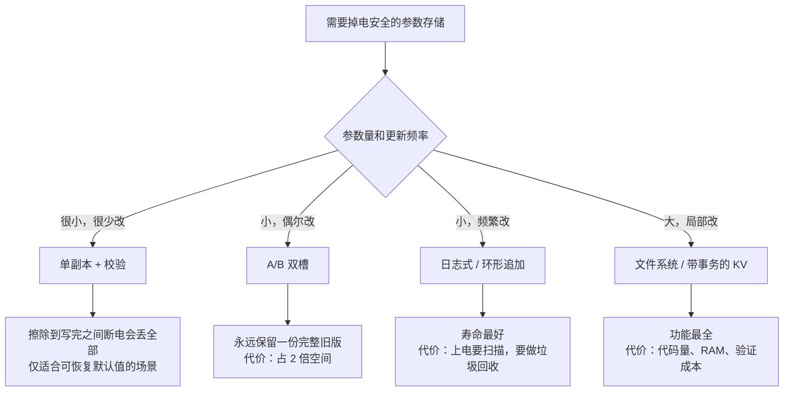
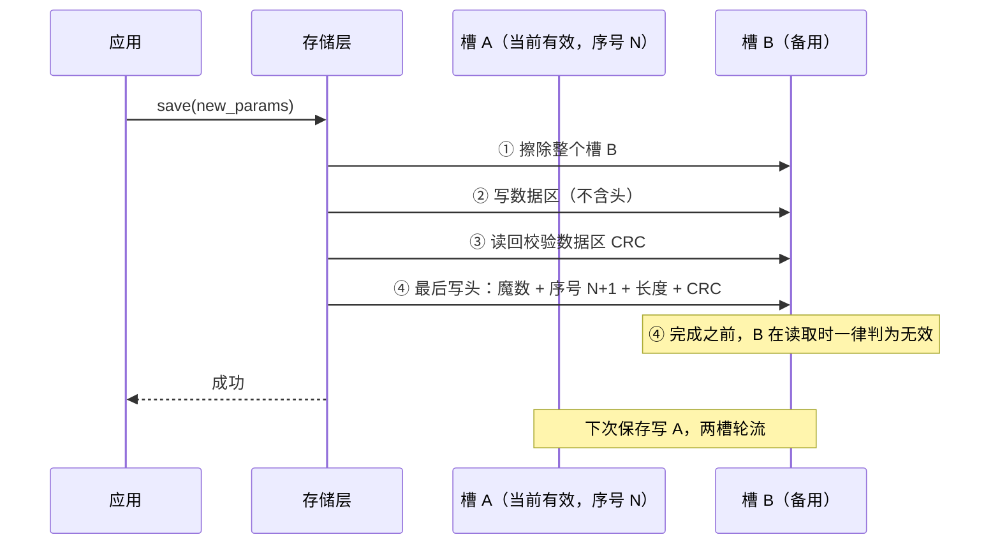
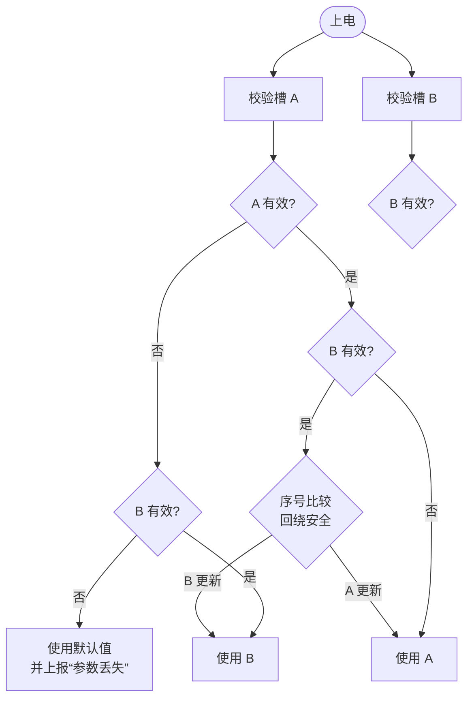

> 读者假设：做过几年嵌入式，用过 Flash 存参数，但没系统地推导过"为什么这样设计才掉电安全"。
> 本文只讲通用设计方法。示例数值都是为了讲解而取的。

## 1. 要解决的问题与约束

要求只有一句话：**任何时刻断电，上电后读到的参数要么是完整的旧版本，要么是完整的新版本，绝不能是第三种。**

难点来自 NOR Flash 的物理特性：

| 特性 | 后果 |
|---|---|
| 编程只能 1→0，擦除才能 0→1 | 不能"原地改一个字节"，改动必须先擦 |
| 擦除粒度大（扇区，几 KB～上百 KB） | 擦一次就破坏整个扇区里的所有内容 |
| 擦除耗时长（几十到几百毫秒） | 断电窗口很宽，不是一个"瞬间" |
| 擦写寿命有限（常见 1 万～10 万次） | 频繁保存会写穿，要考虑磨损 |
| 编程粒度有最小单位（如 1 字节、页、或 ECC 字） | 写到一半断电，**单个字内部也可能处于中间态** |

最后一条最容易被忽略：断电不仅会让"一次保存"只完成一半，还可能让**单次编程本身**留下介于 0 和 1 之间的电平，读出来时值不稳定。所以"写了标记"不等于"标记可信"，必须有校验。

## 2. 方案对比



| 方案 | 掉电安全 | 空间 | 寿命 | 复杂度 | 适用 |
|---|---|---|---|---|---|
| 单副本 + CRC | ✗ 擦写窗口内会丢全部 | 1× | 一般 | 最低 | 丢了能恢复出厂值 |
| **A/B 双槽** | ✓ | 2× | 好（两槽轮流） | 低 | 标定、配置这类"整体替换"的参数 |
| 日志追加 | ✓ | 多个扇区 | 最好 | 中（要 GC） | 高频小更新（计数器、运行日志） |
| KV / 文件系统 | ✓ | 取决于实现 | 好 | 高 | 参数多、结构不固定 |

一类典型场景是"标定类参数：整体校验、整体替换、更新很少"，A/B 双槽的复杂度和可验证性最划算。放弃日志式的理由：参数是整体一致性对象，不适合拆成多条记录各自生效。

## 3. A/B 双槽的核心：提交点放在最后



要点：

1. **头最后写。** 头是"提交记录"，只有它写完整，这个槽才算生效。
2. **头自身也要能自证完整**：魔数 + 序号 + 长度 + **数据区 CRC** + 头自身的 CRC。头里记录数据区 CRC，是为了防止"头写成功了，但数据区有位没写好"。
3. **读取时不信任任何标记，只信校验**：对每个槽独立做"魔数 → 头 CRC → 长度合法 → 数据 CRC"四步，通过才是候选。

### 读取（上电）流程



## 4. 容易写错的几个设计点

**4.1 序号回绕。** 序号是 32 位无符号数，比较要用差值判断，而不是直接 `a > b`：

```c
/* 返回 1 表示 a 比 b 新 */
static int seq_newer(uint32_t a, uint32_t b)
{
    return (int32_t)(a - b) > 0;
}
```

直接比较在回绕点会选错槽。（序号永远不回绕在工程上也成立，但写错代价高，成本很低就能防。）

**4.2 "两个都有效且序号相同"。** 理论上不该出现，但要定义行为（比如固定选 A 并告警），不要让它变成未定义行为。

**4.3 擦除后断电的槽读出来是什么。** 擦除未完成的扇区里，位可能处于不稳定状态，**读出来的值甚至两次读不一致**。所以不能假设"被打断的擦除会读成全 FF"。依赖校验失败来判无效，而不是依赖内容。

**4.4 写前先读备用槽的状态。** 如果备用槽上次写到一半就断电，里面有半成品。必须重新擦除再写，不能在原地续写。

**4.5 代码在同一片 Flash 里执行（XIP）。** 擦除和编程期间，Flash 不能同时被取指。解决办法：

- 擦写函数放在 RAM 里执行（链接到 RAM 段）；
- 或使用芯片 ROM 提供的擦写接口；
- 擦写期间关中断，或保证中断服务程序也在 RAM；
- 注意看门狗：擦除一个大扇区可能就会超过喂狗周期。

**4.6 磨损。** 两槽轮流，每个槽承担一半的写入。如果参数有 N 个字节，一次保存擦写一个槽：

```text
寿命（次保存）≈ 擦写寿命 × 2
```

如果保存很频繁（例如运行中周期保存），要么降低频率、要么换日志式方案，不能硬用 A/B。

## 5. 失效模式分析（按断电时刻逐个推演）


| 断电时刻 | 备用槽状态 | 上电结果 | 是否安全 |
|---|---|---|---|
| ① 擦除中 | 不稳定内容，无有效头 | 用当前槽（旧） | ✓ |
| ② 写数据中 | 无头 | 用当前槽（旧） | ✓ |
| ③ 校验前后 | 无头 | 用当前槽（旧） | ✓ |
| ④ 写头中 | 头可能半写 | 头 CRC 不过 → 旧 | ✓ |
| ④ 写头完成 | 完整头 + 完整数据 | 序号更新 → 新 | ✓ |
| ④ 完成后、返回前 | 同上 | 新（应用也以新为准） | ✓ |

最微妙的是"④ 写头中"：头里每个字都可能处于中间态，但头 CRC 通不过就会被当成无效，**依赖的是 CRC 的检测能力而不是时序**。所以 CRC 选择、头的布局要经过评估：头字段要有足够的校验覆盖，而不是只校验数据区。

## 6. 怎么验证：用故障注入穷举，而不是靠推演

推演表格容易漏。真正可靠的是在主机上做穷举。

```mermaid
flowchart TD
    M[用内存数组模拟 Flash<br/>支持：擦除/编程/读] --> H[在每次擦除和编程<br/>前后挂钩子]
    H --> I[注入点 k：第 k 次操作处<br/>让它只完成一部分并"断电"]
    I --> R[重新"上电"，读取结果]
    R --> C{结果是旧版本<br/>或新版本?}
    C -->|是| OK[通过，k+1]
    C -->|否| BUG[发现缺陷，保存现场]
    OK --> I
```

做法：

1. 模拟 Flash 的物理规则（编程只能 1→0，擦除置全 1，擦除/编程可被"部分完成"）；
2. 对一次保存里的每一个擦除和每一个编程操作，分别模拟"完全没做 / 做了一部分 / 做完"；
3. 每种情况后重新读取，断言：**结果必须逐字节等于旧参数或新参数**；
4. 对"部分完成"的编程，随机把半个字写成中间值，覆盖 4.3 的情况。

**变异测试**：验证测试本身有效——故意把实现改坏（如去掉头 CRC、把"头最后写"改成"头先写"、序号比较改成直接大于），测试应该失败。能把这些变异全部抓住，测试才可信。

主机之外再补两类上板测试：

- **掉电台架**：继电器切断电源，在保存过程的随机时刻断电，几千次后统计异常；
- **长时间磨损测试**：快速反复保存，观察擦写寿命下降和读写错误率。

## 7. 小结

- A/B 双槽的安全性来自两条：**提交点放在最后** + **读取时只信校验**。
- 序号比较要回绕安全；擦除被打断的内容要当作不可信。
- XIP、看门狗、中断是落地时最常见的坑。
- 用"每一步都断电"的穷举测试加变异测试，比推演可靠得多。
- 方案选择看更新频率：高频小更新不要硬用 A/B，改用日志式。
