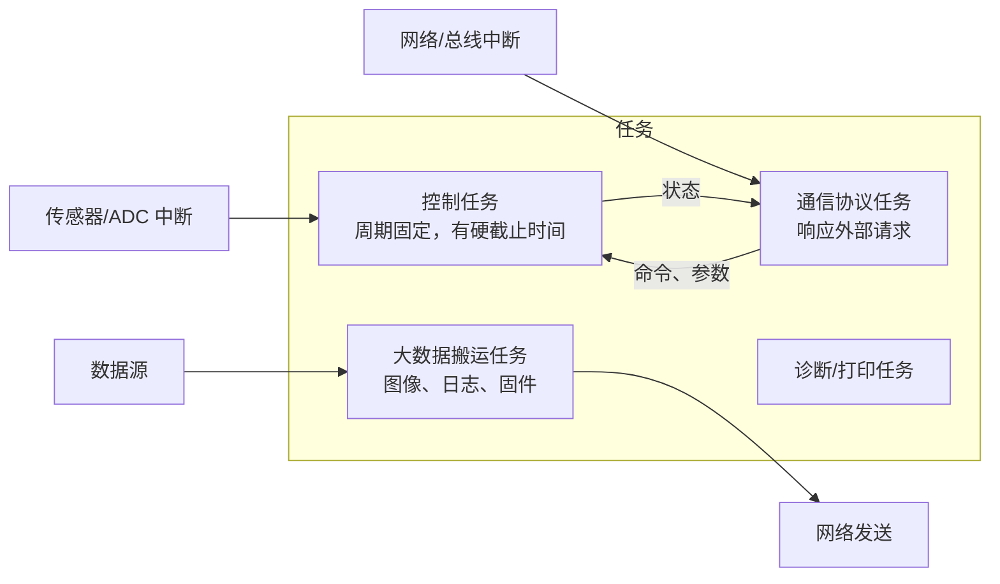
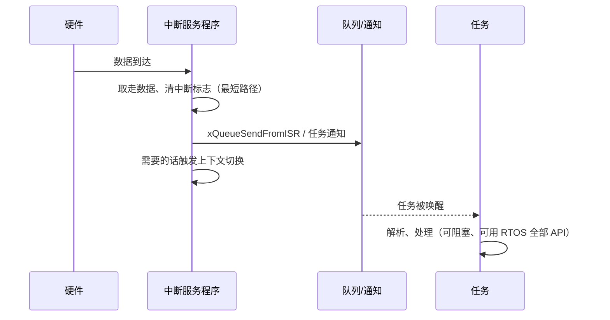
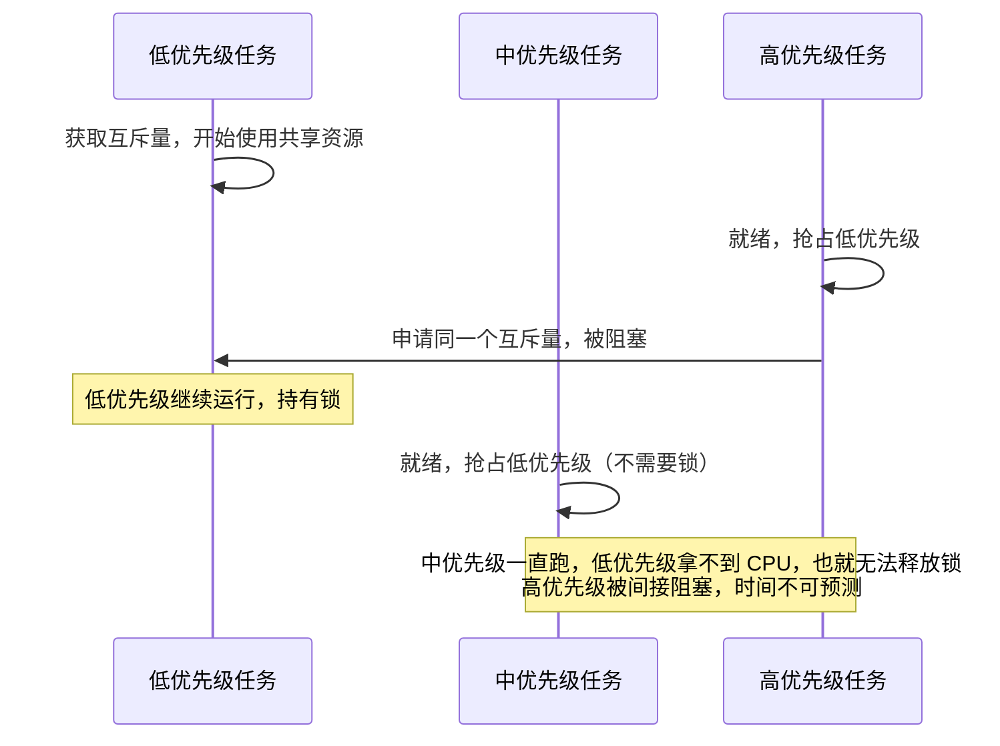
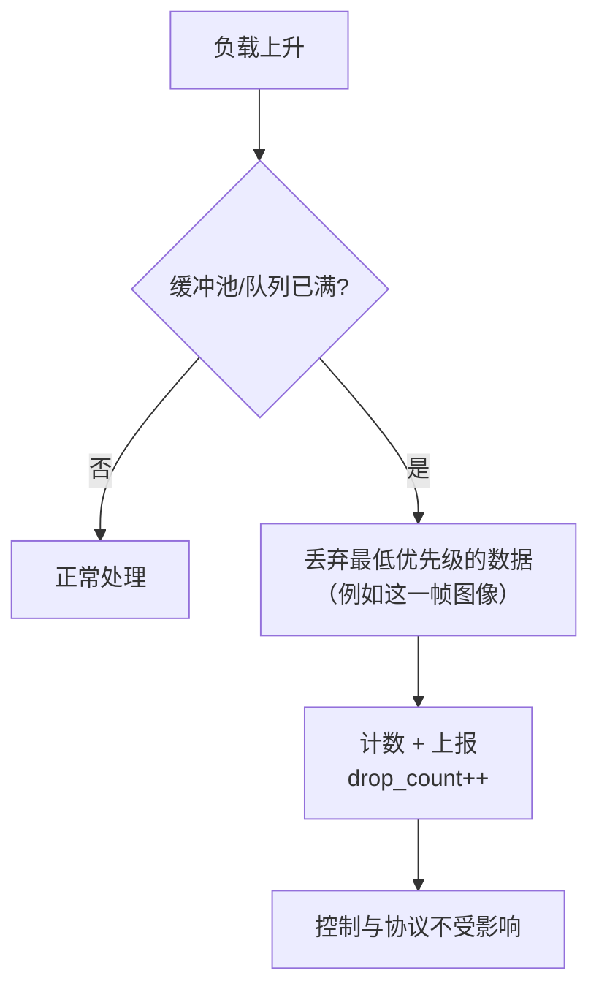

"给任务分优先级"听起来像是配置问题，实际上是**一个系统在过载时到底牺牲谁**的设计问题。很多实时性故障（周期偶尔抖动、偶发丢数据、莫名卡死）最后都能追到优先级划分、临界区或中断优先级配置上。

这篇文章从"任务怎么划分"讲起，依次覆盖：优先级怎么定、中断与任务怎么分工、优先级反转怎么出现和避免、过载时怎么降级、怎么用数据证明实时性。示例以 FreeRTOS 的概念为主，但思路适用于大多数抢占式内核。

> 前提：你已经写过多任务程序，知道队列、信号量、互斥量的基本用法。

## 1. 先画"谁依赖谁"，再谈优先级

不要从"哪个功能重要"出发，要从**截止时间和数据流**出发。一个典型的控制类设备大致是这样：



我的划分原则：

1. **周期任务按"截止时间越短越高"排**（速率单调的思路）；
2. **事件驱动任务按"错过了的后果"排**：丢一次响应是重试还是事故；
3. **吞吐型任务放最低**：它们没有截止时间，只要整体不饿死就行；
4. **每一级都留出间隔**（比如 2、4、6、8），以后插入新任务不用重排。

## 2. 中断和任务的分工：中断里只做"让任务醒来"



规则：

- 中断里只用 `FromISR` 后缀的 API，**不要阻塞、不要 printf、不要做长循环**；
- 把耗时的工作交给任务，中断持续时间越短，对其他任务的抖动影响越小；
- 任务通知（task notification）比队列轻量，适合"只需要唤醒"的场景；要传数据才用队列。

### 一个经常被忽略的点：中断优先级与内核临界区

在 Cortex-M 之类带可屏蔽优先级的内核里，RTOS 有一个"最高可调用系统 API 的中断优先级"（FreeRTOS 里叫 `configMAX_SYSCALL_INTERRUPT_PRIORITY`）：

- **比它高的中断**：不会被内核临界区屏蔽，延迟最小，但**不能调用任何 RTOS API**；
- **不高于它的中断**：可以调用 `FromISR` API，但在内核临界区里会被屏蔽。

所以把真正对延迟敏感、又不需要 RTOS 服务的中断（例如高速控制环的采样）放在"更高"一档，是常用的设计。不同架构的细节不同（有的平台没有这种分级，临界区直接关全部中断），**要读自己平台的移植说明**。

## 3. 优先级反转：三个任务就能出事



结果是：**高优先级任务被中优先级任务间接拖住了**，延迟没有上界。

办法：

1. **使用带优先级继承的互斥量**：持锁的低优先级任务临时继承等待者的优先级，尽快跑完并释放。FreeRTOS 的互斥量有，二值信号量**没有**，别用二值信号量当锁。
2. **缩短持锁时间**：持锁期间不要做耗时操作、不要再去申请别的锁。
3. **能不共享就不共享**：用队列把"访问共享资源"的工作交给唯一的拥有者任务，比用锁更简单。
4. **持锁时不要阻塞等待事件。**

## 4. 过载时怎么办：先决定"谁让谁"

系统一定会遇到某些时刻忙不过来：网络突发、日志刷屏、某个传感器抖动。没有事先决定好的话，表现往往是**控制周期被拉长**，这是最糟的结果。

我的做法是明确一条优先链，并让低优先级一方**主动退让**：



要点：

- **预留缓冲池，满了就丢**，不要让生产者无限等待消费者；
- **丢弃要可见**：有计数、能被诊断接口读出，否则是"悄悄变差"；
- **控制任务的执行时间要有上限**，不依赖外部输入的多少；
- 过载测试要专门做：把低优先级业务全部打满，观察控制周期抖动。

> 一个实际现象：低优先级任务被压住时，它自己的发送变慢、缓冲满，丢帧率上升。这是预期行为，说明系统在按优先链降级；真正要警惕的是**控制周期变差**。

## 5. 栈、堆与诊断

**栈大小**不靠猜。FreeRTOS 提供栈使用的"历史最低剩余量"（high water mark），把它周期性打印出来：

```text
task=proto   stack_left(words)=1820
task=control stack_left(words)=412
```

做法：先给较大的栈，跑最坏场景，再按"历史最低剩余量"收紧，并**保留 25%～50% 的裕量**；打开栈溢出检测（方法二，填充魔数检查）作为最后防线。

**堆**要关注两件事：总量和碎片。选择 `heap_4`（带合并）之类的分配方案，并在运行时输出"当前剩余"和"历史最小剩余"；动态分配只放在初始化阶段，运行中不再 `malloc`。

**CPU 占用**用运行时统计（run-time stats）看各任务占比，并和预期对比。

## 6. 怎么证明实时性：测周期抖动

感觉没问题不算数，要测：


三个测量要点：

1. 用**硬件定时器的周期中断**触发任务，别只用 `vTaskDelay`，后者的周期受调度影响；
2. 在代码里也记录"实际开始时间 - 理想开始时间"，累计最大偏差；
3. **最忙场景**才是测试重点，空载下的结果没有说服力。

## 7. 常见的坑

| 症状 | 常见原因 |
|---|---|
| 偶发随机崩溃 | 栈溢出；中断里调用了非 `FromISR` 的 API |
| 周期偶尔抖动几百微秒 | 临界区太长；日志/打印在高优先级路径里；缓存未命中 |
| 优先级配了但没效果 | 第三方库自己建任务，且把优先级数值换算反了（有的库用"最大优先级减去数值"） |
| 死锁 | 嵌套持锁顺序不一致；持锁时阻塞等待 |
| 任务饿死 | 高优先级任务忙等，从不阻塞 |
| 看门狗偶发复位 | 低优先级任务（喂狗）被长期压住 |

## 8. 局限

- 本文假设单核抢占式调度；多核（SMP / AMP）下的亲和性、核间通信和缓存一致性是另一个话题。
- 没有展开形式化的可调度性分析（RMS、响应时间分析），实际工程里常用"测量加裕量"代替。

## 延伸阅读

- 《Mastering the FreeRTOS Real Time Kernel》（官方免费电子书），重点看任务通知、中断管理和资源管理章节。
- 你所用 RTOS 针对目标架构的移植说明，重点看中断优先级与临界区的实现。
