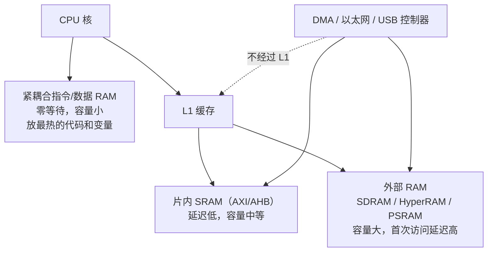
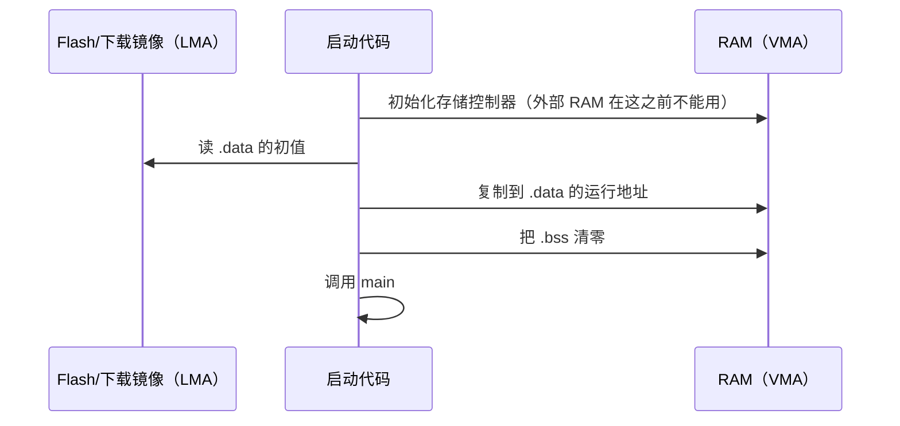
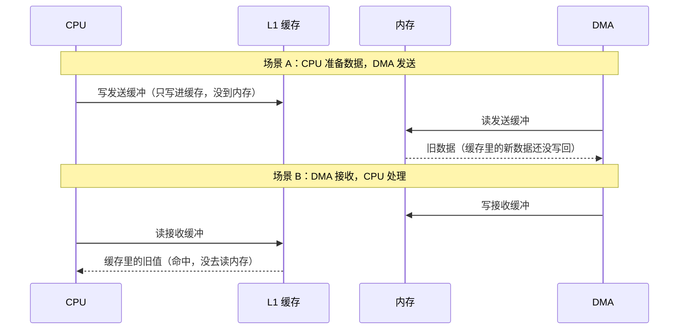
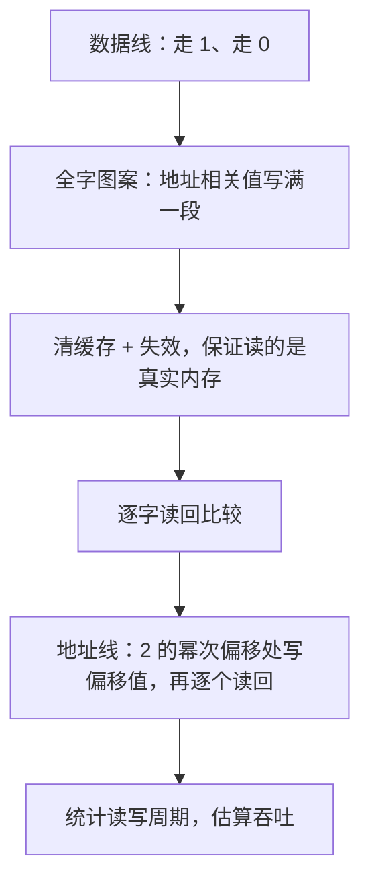

内存相关的 bug 有一个共同特点：**症状和原因离得很远**。数据偶尔是旧的、DMA 收到的包有几个字节不对、某个全局变量上电后不是 0、加了一个功能后整个程序慢了一截……最后都可能回到"这块东西放错了地方"。

这篇文章把一块芯片的内存当作一个系统来讲：段是怎么被链接脚本分配的、启动代码要替你做什么、缓存和 DMA 为什么会打架、外部大容量 RAM 该放什么不该放什么，最后给出一套验证办法。

> 前提：你写过链接脚本或至少读过 map 文件；用过带数据缓存的 MCU 或 SoC 更好。

## 1. 先看全局：多块存储器，各有脾气

现在的 MCU/SoC 往往同时有好几类存储：



两条关键信息：

1. **CPU 经过缓存访问内存，DMA 通常不经过。** 这是缓存一致性问题的根源。
2. **外部 RAM 的"带宽够"不等于"延迟低"。** 缓存行填充时要等外部总线，几十个周期量级（取决于控制器），热点路径不要放。

## 2. 链接脚本在做什么

编译产物是一堆**段**：`.text`（代码）、`.rodata`（只读数据）、`.data`（有初值的变量）、`.bss`（零初值变量），再加你自己定义的段。链接脚本回答两个问题：

1. 内存区域有哪些（`MEMORY`）；
2. 每个段放进哪个区域（`SECTIONS`）。

```text
MEMORY
{
    FAST_RAM (wx) : ORIGIN = 0x00000000, LENGTH = 256K
    MAIN_RAM (wx) : ORIGIN = 0x01200000, LENGTH = 768K
    NONCACHE (w)  : ORIGIN = 0x012C0000, LENGTH = 128K
    EXT_RAM  (w)  : ORIGIN = 0x40000000, LENGTH = 32M
}

SECTIONS
{
    .text  : { *(.text*)  } > MAIN_RAM
    .data  : { *(.data*)  } > MAIN_RAM AT > FLASH   /* 运行地址 vs 加载地址 */
    .bss   (NOLOAD) : { *(.bss*) *(COMMON) } > MAIN_RAM
    .noncacheable (NOLOAD) : { *(.noncacheable*) } > NONCACHE
    .extram (NOLOAD) : { *(.extram*) } > EXT_RAM
}
```

在 C 里用属性把变量放进自定义段：

```c
static uint8_t dma_buf[4096]  __attribute__((section(".noncacheable"), aligned(64)));
static uint8_t big_pool[96*1024] __attribute__((section(".extram.pool")));
```

### 加载地址（LMA）和运行地址（VMA）

`.data` 的初值要存在非易失存储里，运行时却要在 RAM。所以同一个段有两个地址：



几个常见误区：

- **`NOLOAD` 段不会被下载，也不会被启动代码初始化。** 里面是什么取决于上电状态，必须自己初始化。很多"上电后值不对"的 bug 都是因为默认以为所有静态变量都是 0。
- **自定义段不在启动代码的清零范围内**，除非你在脚本里导出符号并让启动代码处理。
- **外部 RAM 在使用前必须初始化控制器**，而且要在任何放在里面的全局变量被访问之前。放进外部 RAM 的全局变量，若有构造/初值，就受这个顺序约束。
- **用 `ASSERT` 在链接期拦截问题**，例如"热点代码不能超过紧耦合 RAM 大小"，比运行时才崩溃好得多。

## 3. 缓存与 DMA：两种方向的错误

假设数据缓存是写回（write-back）的：



两种错误对应两种操作：

| 方向 | 发生什么 | 操作 |
|---|---|---|
| CPU→DMA（发送） | 数据还在缓存里 | 启动 DMA 前对该区域做**清理（clean / write-back）** |
| DMA→CPU（接收） | 缓存里是旧值 | DMA 完成后、CPU 读之前对该区域做**失效（invalidate）** |

细节陷阱：

1. **缓存操作按缓存行（通常 32 或 64 字节）进行。** 缓冲区起始地址和长度必须按缓存行**对齐**，否则会误伤相邻变量：失效时，同一个缓存行里别人尚未写回的数据会被丢掉。
2. **DMA 描述符也是 DMA 访问的内存**，同样要考虑一致性，通常放不可缓存区。
3. **不可缓存区域**（通过 MPU 或类似机制配置）是最省心的办法：DMA 缓冲、描述符、核间共享数据都放进去。代价是 CPU 访问变慢，所以只放需要的东西，并控制大小。
4. **属性要在使用前配置好**，并且注意某些平台要求不可缓存区的大小是 2 的幂、起始地址按大小对齐。

> 一个判断办法：如果一块内存**只被 CPU 访问**（例如 CPU 把 USB 数据拼成一帧，再由 CPU 拷贝到网络协议栈），完全可以放在**可缓存**区域，不需要 DMA 的那些处理，速度还更好。只有 DMA 直接读写的才需要不可缓存。

## 4. 外部 RAM 放什么，不放什么

| 适合放 | 不适合放 |
|---|---|
| 大块缓冲（图像帧、录波数据、日志环形缓冲） | 控制环的代码和数据 |
| 访问是顺序、成块的数据 | 随机访问、小粒度、频繁的数据 |
| 允许延迟抖动的数据 | 中断服务程序里要用的数据 |
| CPU 独占访问的缓冲 | 堆（尤其是 RTOS 内核对象） |

原因：

- **缓存行填充延迟高且不稳定**：外部 RAM 的刷新、与其他总线主设备争用都会引入抖动；
- **可缓存**的外部 RAM 在顺序访问下，缓存行一次取回 64 字节，实际吞吐能到几十到上百 MB/s；随机访问则退化到每次几十个周期；
- 如果外部 RAM 与 Flash 共用同一个控制器，取指和数据访问会互相争用，要先确认拓扑。

## 5. 怎么验证：不要假设，要测

### 5.1 读 map 文件

关注三点：每个区域用了多少；大对象在哪；有没有东西落进了默认区域（说明属性没生效）。

```text
Memory region     Used Size  Region Size  %age Used
      FAST_RAM:     4968 B       256 KB      1.90%
      MAIN_RAM:   584920 B       640 KB     89.25%
      NONCACHE:   123144 B       128 KB     93.95%
       EXT_RAM:    98432 B        32 MB      0.29%
```

### 5.2 板上自检：图案加清缓存

对外部 RAM 或新区域，上电后跑一次小自检：



- **数据线测试**抓短路、粘连；
- **地址线测试**抓地址线断路或混叠（读回时会发现不同地址互相覆盖）；
- **清缓存再读**是关键，否则读到的是缓存而不是内存。

### 5.3 测缓存行未命中的延迟

用 CPU 的周期计数器，每隔一个缓存行读一次，先使缓存失效，统计平均周期。这样可以得到各个区域的真实"首次访问延迟"，再来决定把什么放哪。

## 6. 常见现象对照

| 现象 | 常见原因 |
|---|---|
| 全局变量上电不是 0 | 放进了 `NOLOAD` 的自定义段，没人清零 |
| DMA 收到的包偶尔有几个字节是旧数据 | 接收后没做失效；缓冲区没有缓存行对齐 |
| 发出的包偶尔是旧内容 | 发送前没做清理 |
| 加了一个功能整体变慢 | 热点代码被挤出紧耦合 RAM，或数据落到了外部 RAM |
| 外部 RAM 里的变量一访问就死机 | 控制器没初始化，或初始化晚于使用 |
| 某区域大小改动后随机崩溃 | 不可缓存区大小/对齐不满足平台要求 |

## 7. 局限

- 本文不讨论带 MMU 的系统（页表、虚拟地址），那是另一套问题。
- 不同架构的缓存维护指令和 MPU 配置差别很大，细节以芯片手册为准。
- 数值（延迟、吞吐）都是量级参考，要在自己的板子上测。

## 延伸阅读

- 链接器官方手册（GNU ld）中 `MEMORY`、`SECTIONS`、`AT>`、`NOLOAD`、`ASSERT` 的章节。
- 处理器厂商的"缓存与 DMA 一致性"应用笔记。
