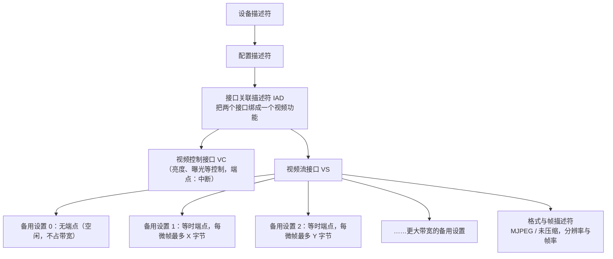
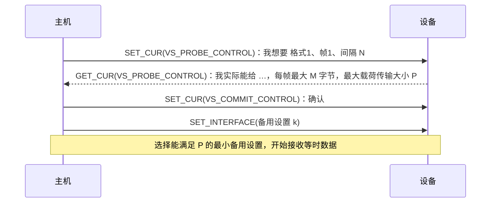
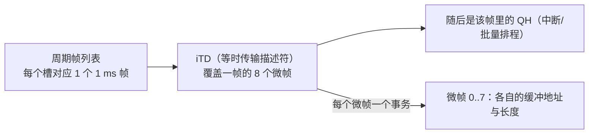
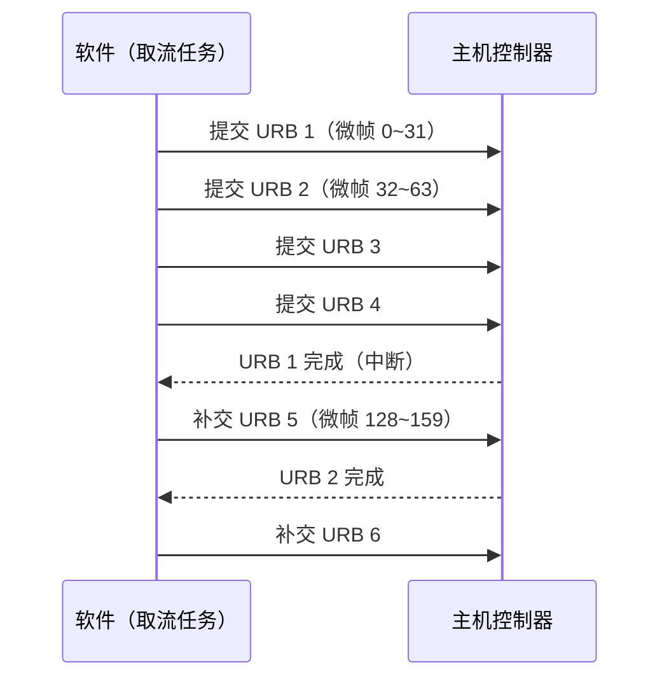
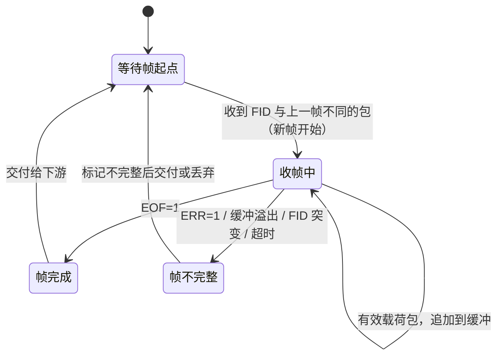
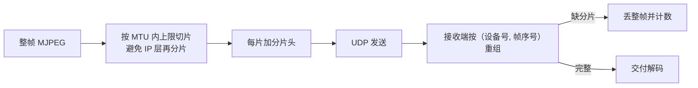

让一个嵌入式设备当 USB **主机**去读摄像头，和在电脑上"插上就能用"完全是两回事。电脑上操作系统替你做了描述符解析、带宽分配、等时调度、拼帧和丢帧处理；嵌入式里这些你得逐层确认：协议栈有没有实现、内存够不够、时序来不来得及。

这篇文章把"一台 UVC 摄像头的一帧画面是怎么走到主机内存里的"拆成五层：描述符、协商、传输调度、包头与拼帧、再往下游转发（如通过网络）。重点放在**出问题时去哪一层找**。

> 前提：了解 USB 基本概念（设备、配置、接口、端点）。本文以高速（High-Speed）设备、EHCI 类主机控制器为背景，示例数值是通用举例。

## 1. 一台 UVC 设备在描述符里长什么样



读完描述符，主机要知道三件事：

1. **设备支持哪些"格式 + 分辨率 + 帧率"组合**（格式/帧描述符）；
2. **每个备用设置对应多大的带宽**（等时端点的 `wMaxPacketSize`）；
3. 视频流接口在哪个接口号上。

### 嵌入式主机在这里最先栽的两个坑

- **配置描述符可能比协议栈默认的请求缓冲大。** 一台带多个格式、多个备用设置的摄像头，配置描述符可以达到几百字节。默认缓冲小了，枚举直接失败，日志里一般会看到"总长度溢出"类的信息。
- **备用设置个数超过协议栈的上限。** 有些协议栈把每个接口最多备用设置数设成很小的默认值，需要调大。

另外，协议栈里很多数组大小是**几个上限参数的乘积**（Hub 数 × 端口数 × 接口数 × 端点数……），全开可能占用上百 KB。嵌入式里应把这些上限调到"刚好够用"，这是 RAM 占用的大头。

## 2. 协商：Probe / Commit

主机不是直接"开始收视频"，而是先和设备商量参数：



关键点：

- 设备返回的 `dwMaxPayloadTransferSize` 决定**需要多大带宽**，主机据此选择备用设置，而不是自己猜；
- 带宽可能被**总线上其他设备占用**：高速总线每微帧 125 µs 的预算有限，多个摄像头同时取流，要看总预留是否超过限制；
- 选不到合适备用设置（带宽不够）时，通常要降分辨率或帧率重新协商。

## 3. 等时传输：保证时间，不保证到达

四类传输里，等时是唯一"不重传"的：

| 传输类型 | 保证什么 | 出错后 |
|---|---|---|
| 控制 | 可靠 | 重传 |
| 批量 | 可靠，但不保证时间 | 重传 |
| 中断 | 周期有上界 | 重传 |
| **等时** | **带宽和周期** | **不重传，丢了就丢了** |

对视频来说这是合理的：晚到的画面没有意义，重传反而挤占后面的带宽。所以上层必须**自己检测并处理丢包**。

### 3.1 主机控制器怎么调度等时传输

以 EHCI 为例，等时传输靠"帧列表"调度：



- 每个 iTD 覆盖一个 1 ms 帧里的 8 个微帧，每个微帧可以描述一次事务；
- 等时 iTD 插在帧列表里，**位于同一帧里的 QH 之前**；
- 软件要**提前把未来的若干帧排好**，来不及排就会出现"空微帧"，对应数据丢失。

### 3.2 要做成流水线，而不是一包一提交

每个设备同时挂**多个**在途请求（URB），每个请求覆盖若干微帧；一个完成后，立刻补一个新的：



设计要点：

- **在途 URB 数要能容忍任务被短暂挂起**：任务调度延迟 × 数据速率要小于已排好的时长；
- **完成回调在中断上下文**，只做记录和唤醒，拼帧放到任务里；
- 只在每个 URB 的**最后一个事务**上请求完成中断，能显著减少中断次数；
- 所有包缓冲要用**不可缓存内存**（见上一篇），并保证长度、对齐满足控制器要求。

> 一个现实：有的开源协议栈在头文件里声明了等时相关结构，但**实现缺失**（宏打开后链接才发现函数未定义）。这时需要自己实现等时调度，不要一开始就怀疑设备。

### 3.3 Hub 和事务转换器

如果摄像头是全速设备，挂在高速 Hub 下面，要经过"事务转换器"（TT），使用分割事务，调度复杂得多。很多现代摄像头是高速设备，直接避开这个问题。如果一定要支持，先确认你的主机栈是否支持。

## 4. 载荷包头与整帧重组

等时传来的每一包前面都有一个 UVC 载荷头：

| 字段 | 含义 |
|---|---|
| `bHeaderLength` | 头长度 |
| `bmHeaderInfo` 的 FID | 帧标识，**每帧翻转一次**，用来判断"进入了新的一帧" |
| EOF | 本包是否是当前帧的最后一包 |
| ERR | 设备端报告这一帧有错误 |
| PTS / SCR（可选） | 时间戳 |

重组状态机：



对 MJPEG 还可以做**廉价完整性检查**：帧以 `FF D8` 开头、`FF D9` 结尾；不用解码就能把大多数错帧过滤掉。

### 内存设计

- 缓冲池按"同时在取流的设备数 + 排队等下游的帧数"配置；
- 提供**借出 / 归还**接口：上层给缓冲，取流任务直接写进去，省一次整帧拷贝；
- **没有订阅者时，在包头阶段就直接丢弃**，不占缓冲、不做拷贝。

## 5. 往下游转发：通过 UDP 发一整帧

一帧通常有几千到十几 KB，要分片：

```text
分片头（示意）：
  魔数 | 版本 | 类型 | 设备号 | 标志(首/尾/不完整)
  分片序号 | 分片总数 | 载荷长度 | 帧序号 | 帧总长 | 时间戳
```



几个要点：

- 分片载荷取小于 MTU 的固定值，避免 IP 分片（一个分片丢了整帧都废）；
- **接收端容忍乱序和重复**，用"最新帧序号 - 阈值"来判断更老的未完成帧该丢；
- 把"不完整"标志带到接收端，由上位机决定要不要这帧；
- 订阅/保活机制：接收方显式订阅，发送端超时未收到保活就自动停止，避免对着无人的地址发数据；
- 发送端优先级要**低于控制和协议**（参见 RTOS 那篇）：过载时先丢视频。

## 6. 排查：出问题去哪一层

| 现象 | 往哪层找 | 怎么确认 |
|---|---|---|
| 枚举失败 | 描述符层 | 看日志里的总长度/备用设置溢出，调大缓冲与上限 |
| 枚举成功但没图 | 协商/带宽 | 打印 Probe 返回的最大载荷；换小分辨率或帧率 |
| 图像偶尔花、有断层 | 传输/重组 | 统计错误包、提交失败、帧序号缺口 |
| 帧率低于设备标称 | 流水线/任务调度 | 看在途 URB 数、完成后补交的延迟 |
| 多台同时取流时掉帧 | 带宽/内存 | 检查预留带宽总和与缓冲池大小 |
| 网络端偶尔缺帧 | 下游发送 | 看缓冲池满计数、发送失败数、UDP 丢包 |

## 7. 没验证与局限

- **热插拔**与**长时间运行**要单独测，我这里只讲设计，不讲保证；
- 多设备数量增加时，要同时验证 USB 带宽、内存和网络出口；
- 本文只涉及 MJPEG 路径。未压缩格式的带宽大得多，常常需要更大的备用设置甚至高带宽端点；
- 示例的分片格式是讲解用的，实际应结合接收端的实现需求设计。

## 延伸阅读

- USB-IF 的《USB Video Class》规范与载荷格式文档（UVC 1.5 及相关 payload 规范）。
- 《Enhanced Host Controller Interface Specification for USB》（EHCI 规范），重点看等时传输描述符与周期帧列表章节。
- 你所用 USB 协议栈的主机类驱动文档。
