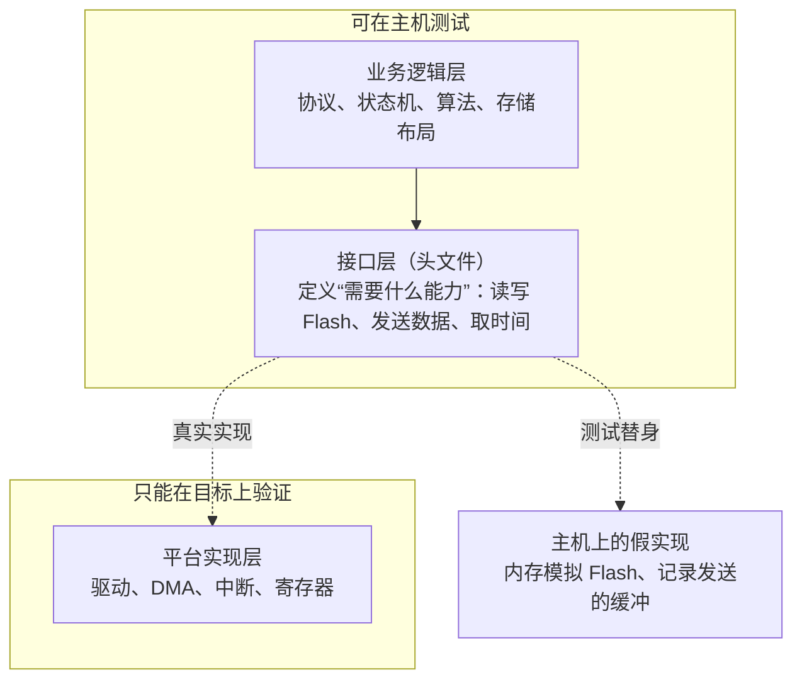
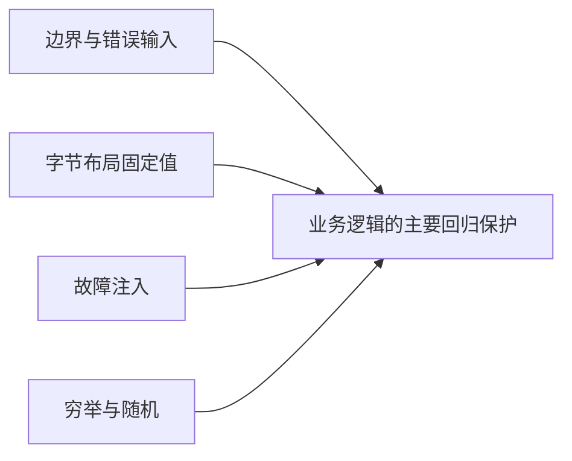
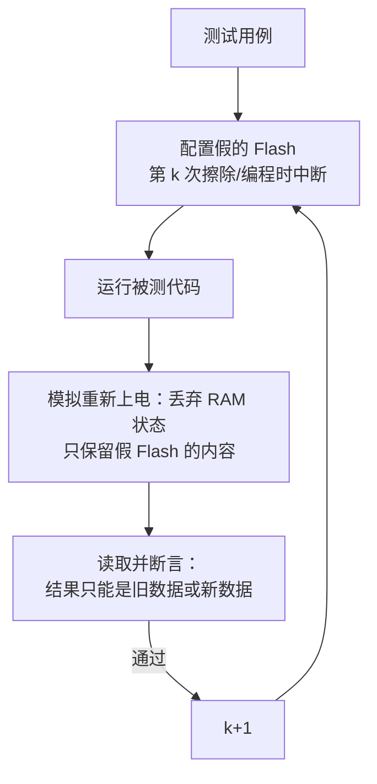
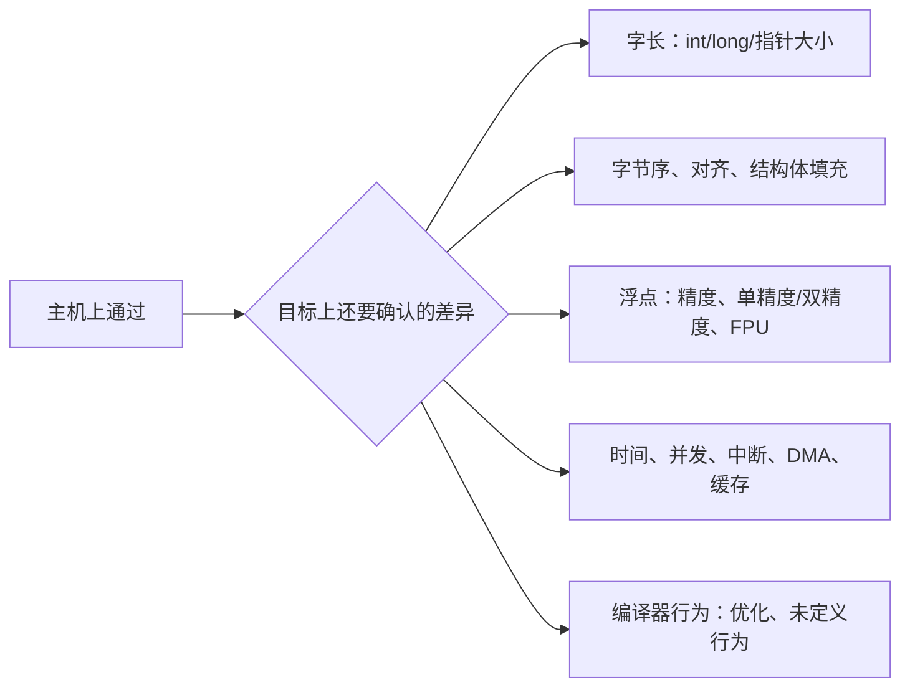
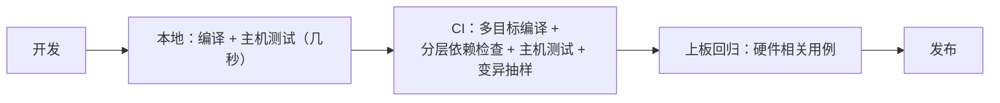

"嵌入式代码必须上板才能测"是一个很容易被默认接受的说法，但它**把一类本可以几秒跑完的测试，变成了要接线、要烧录、要看串口的手工操作**。协议解析、校验、状态机、存储布局、分片重组……这些逻辑大多和硬件无关，完全可以在电脑上用 `gcc` 编译、几毫秒跑完、放进 CI。

这篇文章讲怎么把代码组织成"能在主机上测"的样子、哪些测试值得做、怎样让测试本身可信，以及主机测试**测不到什么**。

> 前提：写过 C 单元测试（哪怕只是 `assert`），了解函数指针与依赖注入的基本做法。

## 1. 前提是分层，而且层间有"接缝"

能在主机上测的代码，是**不依赖具体芯片**的代码。要让这点成立，需要明确的层次和接缝（seam）：



规则：

1. 业务层**不能** `#include` 芯片头文件，也不直接调用 RTOS，只用接口层；
2. 接口层只有头文件，规定**行为契约**，实现有两套：真实的和测试替身；
3. 可以用工具检查依赖方向（脚本扫描 `#include`，把违规数量写进基线，**新增违规必须为 0**）。

### 接缝在 C 里怎么实现

| 方式 | 优点 | 缺点 |
|---|---|---|
| 链接期替换（同一个头文件，链接不同的 `.c`） | 零运行时开销，业务代码无感 | 一个测试程序里只能有一种实现 |
| 函数指针表（"ops 结构"） | 同一个程序里可切换，易于注入故障 | 多一次间接调用 |
| 编译开关 `#ifdef` | 简单 | 容易让业务代码里到处都是条件编译，不推荐 |

我的偏好：**能链接期替换就链接期替换**，需要在运行中切换（比如故障注入）再用函数指针表。

## 2. 哪些测试最值得做



### 2.1 边界与错误输入

对解析、校验类代码，重点是**所有该拒绝的输入都被拒绝**：魔数错、版本错、长度比声明小/大、字段越界、缓冲区刚好装不下。每种错误一条断言，名字描述清楚。

### 2.2 字节布局用"固定的期望值"

线上格式的最大风险是**两端对不上**。做法：把一个典型的头/帧写成固定的字节数组，设备侧和上位机侧的测试**都**对这组字节断言。

```c
/* 设备侧：编码后必须逐字节等于这组期望值 */
static const uint8_t EXPECT[24] = { 0x56, 0x54, 0x01, 0x01, /* ... */ };
assert(memcmp(encoded, EXPECT, sizeof EXPECT) == 0);
```

上位机工具（例如 Python）里用同一组字节做解码断言。任何一端改了格式，总有一个测试失败，不会"悄悄不兼容"。

### 2.2.1 数据驱动，别写一堆复制粘贴

```c
static const struct { uint32_t frame_len, max_payload; } cases[] = {
    {1, 1400}, {1399, 1400}, {1400, 1400}, {1401, 1400}, {12288, 1400},
};
for (size_t i = 0; i < sizeof cases / sizeof cases[0]; i++) {
    /* 分片 -> 重组 -> 逐字节比较 */
}
```

边界值（刚好等于、少一个、多一个）通常是 bug 最集中的地方。

### 2.3 故障注入：模拟会失败的世界

存储、通信这类模块的难点在**异常路径**。用测试替身把异常变成可编程的：



同样的办法适用于：网络丢包与乱序（假套接字）、总线错误帧（假 CAN 驱动）、时钟回绕（假的计时接口）。

### 2.4 随机与模糊

对解析器，用随机/变异输入跑几十万次，只检查"不崩溃、不越界、返回值合法"。配合 **AddressSanitizer / UndefinedBehaviorSanitizer** 在主机上编译运行，能抓到很多在目标上只会表现为"偶尔异常"的问题（越界读、未初始化、有符号溢出）。

## 3. 怎么让测试本身可信：变异测试

测试通过了，不代表测得对。**故意把被测代码改坏，测试必须失败**，这就是变异测试。手工版就很有效：

| 变异 | 期望 |
|---|---|
| 把 `<` 改成 `<=` | 边界用例失败 |
| 去掉一次 CRC 校验 | 错误输入用例失败 |
| 调换提交与写数据的顺序 | 故障注入用例失败 |
| 序号比较改成直接 `a > b` | 回绕用例失败 |
| 字段偏移 +1 | 固定字节布局用例失败 |

做法上可以写一个小脚本：对源文件逐个应用变异、重新编译运行测试、统计"被杀死的比例"，**存活的变异就是测试的盲区**，补用例直到杀死。

配合覆盖率（`gcov`）一起看：覆盖率告诉你代码被执行过，变异测试告诉你**错了会不会被发现**。

## 4. 主机和目标的差异：测试通过不代表在板子上也对



| 差异 | 主机上容易被掩盖的问题 | 对策 |
|---|---|---|
| 类型宽度 | `long` 在主机 64 位、目标 32 位 | 一律用 `uint32_t` 等定宽类型；加 `static_assert(sizeof(...))` |
| 结构体布局 | 直接把结构体当线上格式 | 用显式的编码/解码函数，不要 `memcpy` 结构体 |
| 字节序 | 主机小端，目标可能不同 | 编码函数里显式写字节序，布局测试覆盖 |
| 浮点 | 主机用双精度中间值，结果略有差异 | 控制算法用容差比较，并保留一两组在目标上跑的基准 |
| 并发与中断 | 主机测试是单线程 | 并发相关的逻辑单独设计（无锁队列的单线程模拟+目标上的压力测试） |

**结论：主机测试负责逻辑正确，目标测试负责硬件与时序。** 两者不能互相代替，但可以让目标测试变得更少、更窄、更容易定位。

## 5. 把它放进日常流程



几条实践：

- **提交门槛**：编译通过 + 分层检查新增违规为 0 + 主机测试全绿；
- **每个缺陷修复附一条复现测试**，再提交修复；
- **测试失败时输出足够的现场**：输入、期望、实际、偏移，而不只是 `FAIL`；
- 测试代码也要保持整洁，同样走评审。

## 6. 局限

- 主机测试**抓不到**时序、DMA、缓存、中断抢占、真实外设行为；这些靠目标测试补；
- 故障注入覆盖的是你**想到的**故障模型，现实可能更怪（比如断电后位处于中间电平），所以模型要保守；
- 变异测试有成本，建议对关键模块（存储、协议、安全相关）做，而不是全量。

## 延伸阅读

- 《Test Driven Development for Embedded C》（James Grenning），分层与替身的系统讲解。
- 《Working Effectively with Legacy Code》中关于"接缝（seam）"的章节。
- GCC 的 Sanitizer 文档（ASan、UBSan）与 `gcov` 使用说明。
